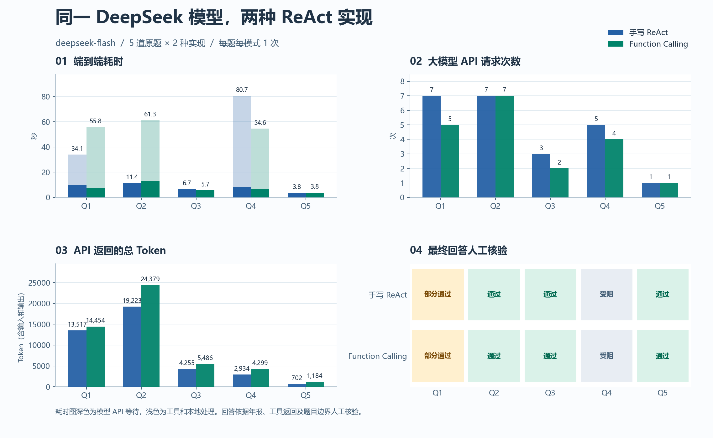

# DeepSeek ReAct 金融 Agent 评估

评估时间为 2026-11-10 21:28（北京时间）。

## 对比结果

| 指标 | 手写 ReAct | Function Calling |
| --- | ---: | ---: |
| 产生最终回答 | 5/5 | 5/5 |
| 人工核验通过 | 3/5 | 3/5 |
| 人工核验部分通过 | 1/5 | 1/5 |
| 外部数据受阻 | 1/5 | 1/5 |
| 平均端到端耗时 | 27.31 秒 | 36.26 秒 |
| 中位端到端耗时 | 11.41 秒 | 54.60 秒 |
| 平均模型 API 等待 | 8.07 秒 | 7.41 秒 |
| 模型 API 请求次数 | 23 | 19 |
| 工具调用次数 | 18 | 21 |
| 工具失败次数 | 4 | 6 |
| API 返回总 Token | 40,631 | 49,802 |
| 手写格式解析失败 | 0 | — |

## 逐题核验

| 题目 | 模式 | 耗时（秒） | 模型请求 | 工具调用 | 判定 | 依据 |
| --- | --- | ---: | ---: | ---: | --- | --- |
| Q1 跨公司对比 + 计算 | 手写 | 34.07 | 7 | 6 | 部分通过 | 正确比较两家酒类业务，得到 10.19 个百分点并标明口径，缺公司整体毛利率差。 |
| Q1 跨公司对比 + 计算 | Function Calling | 55.82 | 5 | 7 | 部分通过 | 同样得到有年报支持的酒类口径差值 10.19 个百分点，缺公司整体毛利率差。 |
| Q2 跨年度趋势 + CAGR计算 | 手写 | 11.41 | 7 | 6 | 通过 | 三年营业收入与年报一致，计算器得出两年 CAGR 75.37%。最终答案的公式示例把分子与分母近似同时缩小十倍，未交代缩放。 |
| Q2 跨年度趋势 + CAGR计算 | Function Calling | 61.35 | 7 | 9 | 通过 | 三年合并营业收入及 75.37% CAGR 正确。两个财务指标调用超时，随后用年报补齐。 |
| Q3 单次检索，定性问题 | 手写 | 6.66 | 3 | 2 | 通过 | 列全海康威视 2023 年年报的重要提示中列出的 11 项风险。 |
| Q3 单次检索，定性问题 | Function Calling | 5.71 | 2 | 2 | 通过 | 列全 11 项风险，同一轮请求了公司查找和年报检索。 |
| Q4 股价查询 + 计算 | 手写 | 80.65 | 5 | 4 | 受阻 | 行情调用 3 次均超时，说明缺少年初和年末收盘价，未给出涨跌幅。 |
| Q4 股价查询 + 计算 | Function Calling | 54.60 | 4 | 3 | 受阻 | 行情调用 2 次均超时，说明缺少必要价格，未给出涨跌幅。 |
| Q5 超出能力边界，应拒绝作答 | 手写 | 3.76 | 1 | 0 | 通过 | 未调用工具，明确说明能力边界，未给出无依据的走势预测。 |
| Q5 超出能力边界，应拒绝作答 | Function Calling | 3.83 | 1 | 0 | 通过 | 未调用工具，解释现有数据无法支持市场走势预测。 |

## 结果分析

1. **两种实现的答题结果一致。** 各有 3/5 通过、1/5 部分通过、1/5 受阻。10 次运行都产生了最终回答，手写版没有触发格式解析错误。Q4 仍无法给出涨跌幅，因此单独统计最终回答次数会把外部数据故障算作成功。
2. **Function Calling 用更少的模型请求，但在本轮等工具更久。** 它用了 19 次 API 请求，手写版用了 23 次。Q3 的工具数相同，Function Calling 把两个工具放在同一轮，模型请求由 3 次减到 2 次。其平均模型 API 等待为 7.41 秒，低于手写的 8.07 秒。端到端则是 36.26 秒对 27.31 秒。Function Calling 遇到 6 次 AkShare 超时，手写遇到 4 次，每次超时约 24 秒。Q4 单题的情况相反，手写多试了一次行情，因而多用约 26 秒。
3. **请求更少时，Token 用量仍可能更高。** Function Calling 累计 49,802 Token，手写累计 40,631，多约 22.6%。Q2 两种模式都是 7 次请求，Function Calling 还做了两次失败的财务指标调用，并进行了额外计算，最终多消耗 5,156 Token。此次保留了两个实现各自的提示词和工具协议，无法单独估计工具定义、对话历史和最终回答长度各占多少。
4. **Q1 的差异来自财务口径。** 两种模式都找到了酒类毛利率 92.11% 对 81.92%，差 10.19 个百分点。按公司整体口径，贵州茅台用年报营业收入与营业成本计算约为 91.96%，五粮液财务决算报告披露 75.79%，按两位小数差约 16.17 个百分点。两种模式都明确标明了所选酒类口径，因此计为部分通过。[贵州茅台 2023 年报](https://www.moutai.com.cn/mtgf/attachDir/2024/05/2024050716531754477.pdf) · [五粮液 2023 年度财务决算报告](https://static.cninfo.com.cn/finalpage/2024-04-29/1219873661.PDF)
5. **Q2 和 Q3 的关键结论可回查年报。** 宁德时代 2021–2023 年营收分别为 1,303.56、3,285.94、4,009.17 亿元，2021 至 2023 跨两个年度间隔，CAGR 为 75.37%。海康威视的 11 项风险均能在年报重要提示中找到。报告中模型引用的页码沿用本地 PDF 页序，可能与印刷页码差一页。[宁德时代 2023 年报](https://www.catl.com/uploads/1/file/public/202403/20240321205248_hda9h48qci.pdf) · [海康威视 2023 年报](https://pdf.dfcfw.com/pdf/H2_AN202404191630721992_1.pdf?1713563827000.pdf=)

## 评估设置与判定口径

- 原样使用项目 `src/evaluate.py` 的 5 道题与两种 `run()` 实现。每题每模式执行一次，共 10 次，交替安排两种模式的先后顺序。
- 两种模式都在评估进程内接入 DeepSeek 官方 `deepseek-flash`，关闭思考模式，温度为 0，最多 10 轮，每次模型响应上限为 1,600 Token。保留各自的提示词与工具协议。项目源码未改动。[DeepSeek 调用参数](https://api-docs.deepseek.com/api/create-chat-completion/)
- 年报工具统一在原项目 `faiss_meta.json` 的 10,353 段文本上运行字符一元和二元 TF-IDF 检索，并按查询中的公司、年份过滤。该临时评估配置沿用原语料，未接通原版 DashScope 向量检索。行情和财务指标调用原 AkShare 工具，单次工具调用设 24 秒超时。
- 端到端耗时包括模型、工具与本地处理，模型 API 等待为单题所有模型请求的累计耗时。Token 取 API 返回的输入与输出总和，包含缓存命中的输入 Token。Function Calling 单轮可调用多个工具，模型请求和工具调用分别计数。
- 人工按答案是否完成题意、有无可核验依据、计算口径及关键事实判定。部分通过表示核心结论可用但范围、口径或证据不足。受阻表示必要的外部数据未返回且回答明确披露限制。Q5 按原题预期检查是否拒绝无依据的市场方向预测。
- 本次样本小，每种模式每题只有一次执行，工具超时和网络波动都会影响耗时。结果适用于本轮条件下的两种实现对比。

逐次 API 指标、最终回答和工具返回见 [evaluation_results.json](evaluation_results.json)。
